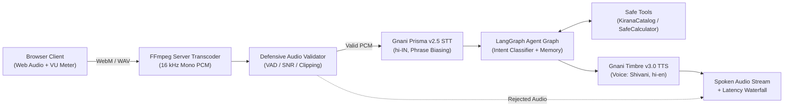

# Kirana Voice Agent — powered by Gnani Prisma + Timbre

> **Hinglish voice agent that takes phone orders for a neighbourhood kirana store.**  
> Built for **The Great Indian Internship Challenge** using **Gnani Prisma v2.5 STT** and **Gnani Timbre v3.0 TTS**.

---

### 📄 Solution Pitch Document
**[Read the one-page Solution Pitch (PITCH.md)](PITCH.md)** — concise summary of the problem, architecture, Gnani speech models, demo flow, and synthetic-data guarantee (required for challenge submission).

---

## ⚡ Overview

Across India, neighbourhood kirana stores process millions of daily orders over phone calls and voice messages. Taking orders while attending to in-store customers leads to missed calls, calculation mistakes, and lost sales. 

The **Kirana Voice Agent** is a voice-first ordering assistant designed for code-mixed **Hinglish** conversations. Customers speak naturally to inquire about prices, check inventory, and order groceries; the agent verifies availability against the synthetic catalog, computes itemized totals using AST-safe arithmetic, and responds with natural Hinglish synthesized speech.

---

## 🏗️ Architecture & Technology Stack

The repository uses **FastAPI + static HTML/JS** with an explicit state machine and real-time telemetry:



### Components
1. **Frontend**: Static HTML5/JavaScript dashboard with Web Audio API capture, live VU meter, AbortController turn cancellation, and stage-by-stage latency waterfall.
2. **Backend**: FastAPI asynchronous server with HTTP turn endpoints, WebSocket streaming, and health probes.
3. **Speech-to-Text (STT)**: **Gnani Prisma v2.5** (`hi-IN`, REST API, ITN number formatting, domain phrase biasing for grocery items like *atta*, *sarso tel*, *doodh*, *chai patti*).
4. **Agent Orchestration**: **LangGraph** rule-based state graph with intent classification, synthetic catalog lookup (`KiranaCatalog`), and 3-turn active session conversational memory.
5. **Deterministic Arithmetic**: AST-safe `SafeCalculator` prevents calculation hallucinations by strictly parsing arithmetic expressions without arbitrary code execution (`eval`).
6. **Text-to-Speech (TTS)**: **Gnani Timbre v3.0** (voice `Shivani`, code-mixed `hi-en`, 16 kHz linear PCM WAV output).
7. **Defensive Audio Filtering**: Validates incoming audio before speech processing, rejecting silence, background noise ($\text{SNR} < 10\text{ dB}$), and clipping.


---

## 📊 Measured Live-Smoke Latencies

The following metrics were verified during live smoke testing against the real Gnani API on 2026-11-09:

| Operation | Input / Output Details | Measured Latency | Status |
| :--- | :--- | :--- | :--- |
| **TTS Synthesis (Timbre v3.0)** | 291,884 bytes / 9.12s audio (`Shivani`, `hi-en`) | **4,889.0 ms** | Verified |
| **STT Round-Trip (Prisma v2.5)** | Real Hinglish audio upload (`hi-IN`, 6/6 terms matched) | **2,171.9 ms** | Verified |
| **End-to-End Turn Total** | Turn speech: 332,844 bytes / 10.40s audio | **7,579.1 ms** | Verified |
| ↳ *Audio Transcode & Validation* | 16 kHz PCM conversion + energy VAD | 257.7 ms | Verified |
| ↳ *STT Transcription (Prisma)* | Live Hinglish recognition | 2,592.0 ms | Verified |
| ↳ *Agent Reasoning & Catalog Total* | `KiranaCatalog` + `SafeCalculator` | 0.06 ms | Verified |
| ↳ *TTS Synthesis (Timbre)* | Code-mixed Hinglish audio generation | 4,705.0 ms | Verified |

*(Zero invented numbers — measured and logged directly during live verification).*

---

## 🚀 Quickstart & Setup

### Prerequisites
- Python 3.11 or 3.12
- `ffmpeg` (required for audio transcoding)

### 1. Clone & Environment Setup
```bash
# Clone the repository
git clone https://github.com/Shashank-VK/gnani-voicepilot.git
cd gnani-voicepilot

# Create virtual environment & install dependencies
python3 -m venv .venv
source .venv/bin/activate
pip install -e ".[dev]"
# Or via Makefile: make setup
```

### 2. Configure Environment Variables
Copy `.env.example` to `.env`:
```bash
cp .env.example .env
```

Set your credentials in your environment at runtime (never commit API keys to version control):
```bash
export GNANI_API_KEY="your-gnani-api-key"
export STT_PROVIDER="gnani"
export TTS_PROVIDER="gnani"
```

### 3. Run the Application
Launch the FastAPI server:
```bash
uvicorn src.voicepilot.main:app --host 0.0.0.0 --port 8000
# Or via Makefile: make run
# Or in demo mode: make demo
```
Open **[http://localhost:8000](http://localhost:8000)** in your browser.

---

## 🎬 Demo & Video Script

- **Demo Prompts & Turns**: See [demo/demo-prompts.md](demo/demo-prompts.md) for dialogue turns, expected replies, and fixture filenames.
- **Shootable Video Script (2–3 Minutes)**: See [demo/DEMO-SCRIPT.md](demo/DEMO-SCRIPT.md) for the timed shootable script with separate narration cues.
- **Walkthrough Guide**: See [docs/demo-script.md](docs/demo-script.md) for screen recording instructions.

### Canonical Demo Turns
1. **Turn 1 (Price Lookup)**: *"Bhaiya, 2 kilo atta kitne ka hai?"* → *"Atta — ₹55 per kilo (2 kilo ka ₹110), stock mein hai (25 kilo available hai). Aur kuch chahiye?"*
2. **Turn 2 (Order & Total ₹255)**: *"2 kilo atta aur 1 litre tel le lo, total kitna hua?"* → *"Aapka order: 2 kilo atta ₹110 + 1 litre tel ₹145 = kul ₹255. Confirm karun?"*
3. **Turn 3 (Stock Inquiry)**: *"Doodh hai kya stock mein?"* → *"Doodh — ₹56 per litre, stock mein hai (10 litre available hai). Aur kuch chahiye?"*
4. **Turn 4 (Second Order ₹190)**: *"1 packet chai patti aur 2 packet biscuit le lo, total kitna hua?"* → *"Aapka order: 1 packet chai patti ₹140 + 2 packet biscuit ₹50 = kul ₹190. Confirm karun?"*
5. **Turn 5 (Model Acknowledgement)**: Spoken summary confirming Gnani Prisma v2.5 STT and Gnani Timbre v3.0 TTS.

---

## 🧪 Automated Test Suite

The test suite covers audio validation, transcoding, Gnani STT/TTS adapters, error mapping, AST-safe calculator, synthetic catalog parsing, FastAPI endpoints, and documentation hygiene:

- **106 tests (43 inherited + 63 new)** for core speech, catalog, agent, and API features.
- Zero paid API keys required for automated CI tests (all external calls mock-tested).

Run tests and linter:
```bash
# Run pytest test suite
make test
# Or: pytest -q

# Run ruff linter
make lint
# Or: ruff check src tests scripts
```

---

## 🔒 Synthetic Data & Privacy Guarantee

- **100% Synthetic Data**: All inventory items, prices, stock quantities, and customer dialogues are completely synthetic. No real customer names, phone numbers, addresses, or Aadhaar/PAN details are used or stored.
- **Transient Audio Processing**: Voice turns are processed in memory and discarded upon completion; no customer audio recordings are retained on disk.
- **Zero Committed Secrets**: API keys are passed strictly via environment variables at runtime and are redacted from all logs.

---

## 📄 License

This project is licensed under the [MIT License](LICENSE).
